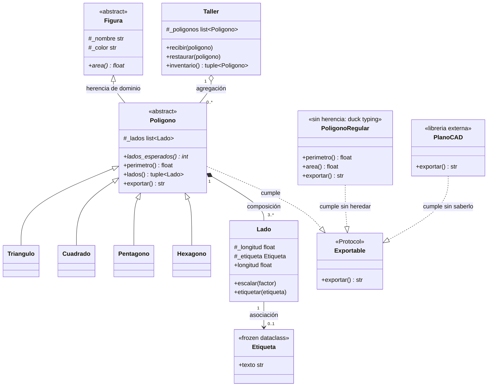

# UML final — TPI POO

## Decisión reflejada

`PoligonoRegular` ya no hereda de `Poligono`: conserva únicamente el comportamiento que necesita y participa en `Exportable` por contrato estructural. La jerarquía nominal queda reservada para los subtipos que el dominio reconoce como especializaciones concretas de `Poligono`.
